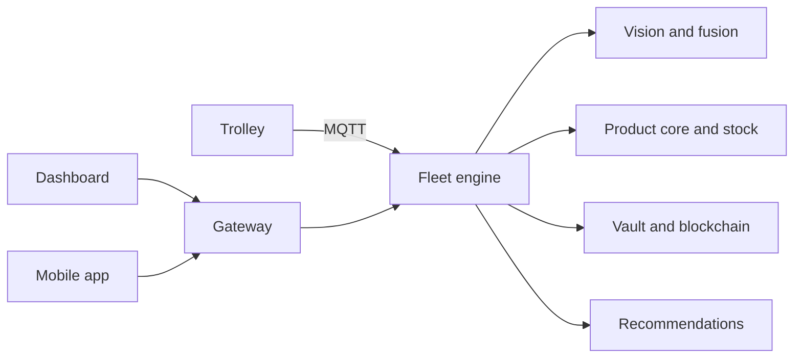

# Automated Supermarket Ecosystem (ASE-PRIME)

A platform for a supermarket with no checkout queues: smart trolleys see and weigh what goes in, stock updates instantly, and payment happens by itself on a private blockchain. It follows the spec in `Automated Supermarket Ecosystem.pdf`.

**Where it stands.** The software runs end to end, with a simulated trolley standing in for the hardware. The physical trolley, a dataset of store photos and real payments don't exist yet. [docs/roadmap.md](docs/roadmap.md) says exactly what has been proven and how.

## Try it

```bash
make stage-b-env    # once: creates stage-b-mvp/.env with random secrets and prints your logins
make stage-b        # needs docker
```

Open <http://localhost>, log in with the admin details it printed, and watch five trolleys shop: a live map, scans being accepted and rejected, recommendations, wallets and purchases landing on the chain.

Hit a `docker-credential-desktop` error? See [stage-b-mvp/README.md](stage-b-mvp/README.md).

## How it fits together



More in [docs/architecture.md](docs/architecture.md), and the API in [docs/api-stage-b.md](docs/api-stage-b.md).

## The three stages

| Stage | Folder | What it is |
|---|---|---|
| A | `stage-a-simulation/` | A single process simulation, with the dashboard and app. Runs with no Docker or login |
| B | `stage-b-mvp/` | The real services in containers. [How to run it](stage-b-mvp/README.md) |
| C | `stage-c-production/` | Kubernetes, navigation, firmware, model training. [What's there](stage-c-production/README.md) |

## Tests

| Command | What it does |
|---|---|
| `make test` | Every unit suite. Each service needs its own install first |
| `make e2e` | A fresh stage B, API checks, the full trolley loop, real outages, a real browser |
| `make k8s-test` | The API checks on a real local Kubernetes cluster, plus network policies and pods being killed. Needs kind and kubectl |

`.github/workflows/test.yml` runs all of these on GitHub Actions, the Besu, observability and TLS runs included.

## Folder structure

```
autimated-supermarket-system/
├── docs/                     architecture, api references, roadmap
├── stage-a-simulation/
│   ├── api-simulator/        node.js simulator
│   ├── mobile-app/           flutter app, for stage a or stage b
│   └── web-dashboard/        next.js dashboard, for stage a or stage b
├── stage-b-mvp/
│   ├── services/             the seven backend services
│   ├── config/               gateway and broker
│   ├── besu/                 ibft 2.0 chain
│   ├── observability/        prometheus and grafana
│   └── e2e/                  end to end tests
├── stage-c-production/
│   ├── k8s/                  kubernetes and argocd
│   ├── robotics/             navigation and ros 2 node
│   ├── firmware/             esp32 load cell
│   └── vision/               model training
└── Makefile                  run make help
```

## Stage A without Docker

```bash
make install
```

This installs the api-simulator and web-dashboard dependencies. `make test` runs every
test suite, and `make help` lists the other shortcuts. The same suites run on GitHub
Actions for every push (`.github/workflows/test.yml`).

## Running the Sim (Stage A)

`make stage-a` starts both servers. To run them separately, use two terminals.

**Terminal 1: Backend**
```bash
cd stage-a-simulation/api-simulator
npm start
# http://localhost:3001
# ws://localhost:3001
```

**Terminal 2: Frontend**
```bash
cd stage-a-simulation/web-dashboard
npm run dev
# http://localhost:3000
```

Open `http://localhost:3000`. The dashboard auto-connects over WebSocket and starts showing
live trolley positions, item scans with confidence scores, blockchain transactions, and AI
recommendations, all updating in real time without a page reload.

**Quick API test with curl:**
```bash
curl http://localhost:3001/api/health
curl http://localhost:3001/api/wallets
curl http://localhost:3001/api/ledger
```

**API Endpoints**
| Method | Path | Description |
|--------|------|-------------|
| GET | `/api/health` | service status + block height |
| GET | `/api/products` | full catalog with dynamic pricing |
| GET | `/api/products/:sku` | single product |
| GET | `/api/wallets` | all wallets |
| GET | `/api/wallets/:id` | single wallet |
| POST | `/api/checkout` | run blockchain checkout |
| GET | `/api/ledger` | last 50 transactions |
| WS | `ws://localhost:3001` | real-time event stream |

## What's Happening Under the Hood

Every 800ms the backend ticks all 5 virtual trolleys. Each trolley does a smooth random walk
around the 800×600 store floor (same coords the canvas map uses, so positions map directly).
There's a 5% chance per tick that a trolley's "load cell" triggers a scan. The simulator
picks a random product, fakes a YOLOv8 confidence score and a load cell reading (±5g, the
spec's precision), and about 1 in 10 scans is deliberately blurry or misidentified. The
fusion step from chapter 5 accepts the scan only if confidence is at least 0.60 and the
weight is within 10g of the catalog weight. Accepted items go into the cart; either way a
SCAN_EVENT fires over WebSocket to every connected client.

When a cart hits 15 items it auto-checkouts, which calls the mock blockchain checkout function
which implements the Limited Overdraft contract from chapter 6 of the spec, generates a real
SHA256 block hash, and fires a CHECKOUT_EVENT that the dashboard uses to update the ledger
and debit the wallet card.

In Stage B this simulator is replaced by MQTT messages and real services, with the same data
shapes, so the dashboard and app work against either one.
