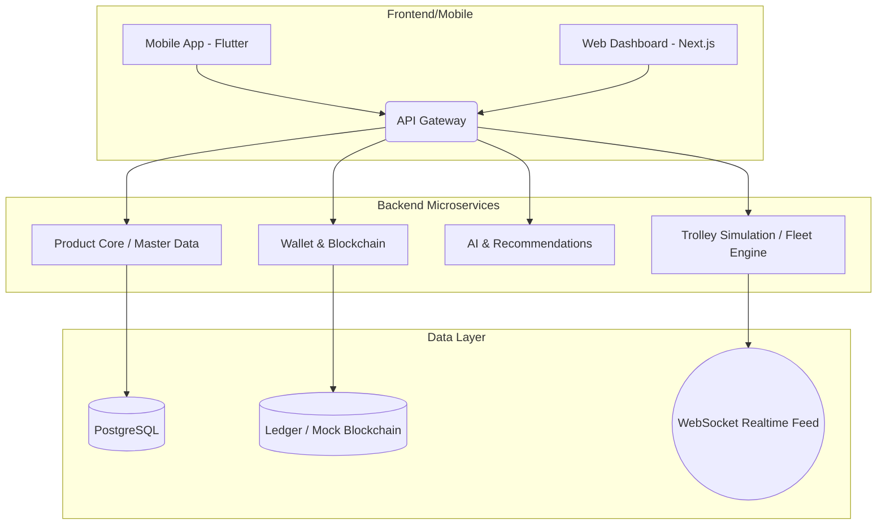

# Automated Supermarket Ecosystem (ASE-PRIME)

This repo holds the code and docs for ASE-PRIME, our automated supermarket platform. We're building this in three stages because testing hardware and robotics right out of the gate is expensive and slow.

## The Big Picture

The goal is to eliminate checkout lines entirely using smart trolleys (cameras, weight sensors) and an edge-to-cloud architecture. Since we can't afford a warehouse full of Jetson Nanos and LiDAR sensors right now, we are simulating the physical layer first.



## How We're Building This

Our approach is split into three realistic stages. This repository's structure mirrors these stages so we don't end up with a mess.

### Stage A: Simulation (Where we are now)
Located in `stage-a-simulation/`. We're building a full-stack demo to validate the concept and UX.
- **Web Dashboard:** A Next.js command center. It shows a live map with moving trolleys, a real-time feed of items being "scanned", and our blockchain wallet interface.
- **API Simulator:** A Node.js backend that fakes the hardware. It generates trolley movement paths, fakes vision/weight sensor events, and handles the mock blockchain ledger.
- **Mobile App:** A Flutter scaffold for the customer-facing app (wallet, cart, and recommendations).

### Stage B: MVP Microservices
Located in `stage-b-mvp/`. This is where we break the monolithic simulator into actual containerized services (Service A: Product Core, Service C: Blockchain Vault, Service D: AI Recommendations) with real Postgres, Redis, and a proper message broker (MQTT/RabbitMQ).

### Stage C: Hardware Integration (Production)
Located in `stage-c-production/`. The real deal. Code that will actually run on the Jetson Orin Nano inside the smart trolleys. YOLOv8 models, ROS 2 navigation scripts, and deepstream pipelines.

## Folder Structure

```
autimated-supermarket-system/
├── docs/
│   ├── architecture.md       # mermaid diagrams, data flow, tech decisions
│   ├── api-reference.md      # all REST endpoints + websocket event schemas
│   └── roadmap.md            # what's done, what's next
├── stage-a-simulation/       # Phase 1, fully working
│   ├── api-simulator/        # Node.js backend (trolley sim, mock blockchain, product API)
│   ├── mobile-app/           # Flutter customer app (cart, wallet, home screen)
│   └── web-dashboard/        # Next.js admin dashboard (live map, ledger, scan feed)
├── stage-b-mvp/              # Phase 2, product-core, vault and ai-engine run in docker compose
├── stage-c-production/       # Phase 3, hardware spec and roadmap
├── Makefile                  # install, start and stop shortcuts
└── README.md
```

## First Time Setup

```bash
make install
```

This installs the api-simulator and web-dashboard dependencies. `make test` runs every
test suite, and `make help` lists the other shortcuts.

## Running the Sim (Stage A)

`make stage-a` starts both servers. To run them separately, use two terminals.

**Terminal 1 — Backend**
```bash
cd stage-a-simulation/api-simulator
npm start
# http://localhost:3001
# ws://localhost:3001
```

**Terminal 2 — Frontend**
```bash
cd stage-a-simulation/web-dashboard
npm run dev
# http://localhost:3000
```

Open `http://localhost:3000`. The dashboard auto-connects over WebSocket and starts showing
live trolley positions, item scans with confidence scores, blockchain transactions, and AI
recommendations — all updating in real time without a page reload.

**Quick API test with curl:**
```bash
curl http://localhost:3001/api/health
curl http://localhost:3001/api/wallets
curl http://localhost:3001/api/ledger
```

**API Endpoints**
| Method | Path | Description |
|--------|------|-------------|
| GET | `/api/health` | service status + block height |
| GET | `/api/products` | full catalog with dynamic pricing |
| GET | `/api/products/:sku` | single product |
| GET | `/api/wallets` | all wallets |
| GET | `/api/wallets/:id` | single wallet |
| POST | `/api/checkout` | run blockchain checkout |
| GET | `/api/ledger` | last 50 transactions |
| WS | `ws://localhost:3001` | real-time event stream |

## What's Happening Under the Hood

Every 800ms the backend ticks all 5 virtual trolleys. Each trolley does a smooth random walk
around the 800×600 store floor (same coords the canvas map uses, so positions map directly).
There's a 5% chance per tick that a trolley's "load cell" triggers a scan. The simulator
picks a random product, fakes a YOLOv8 confidence score and a load cell reading (±5g, the
spec's precision), and about 1 in 10 scans is deliberately blurry or misidentified. The
fusion step from chapter 5 accepts the scan only if confidence is at least 0.60 and the
weight is within 10g of the catalog weight. Accepted items go into the cart; either way a
SCAN_EVENT fires over WebSocket to every connected client.

When a cart hits 15 items it auto-checkouts — that calls the mock blockchain checkout function
which implements the Limited Overdraft contract from chapter 6 of the spec, generates a real
SHA256 block hash, and fires a CHECKOUT_EVENT that the dashboard uses to update the ledger
and debit the wallet card.

In Stage B this whole simulator gets replaced by real MQTT messages from actual trolley
hardware, but all the data shapes stay exactly the same so the frontend shouldn't need
any changes.

---
*actively being developed — stage A is complete, stage B is next*
