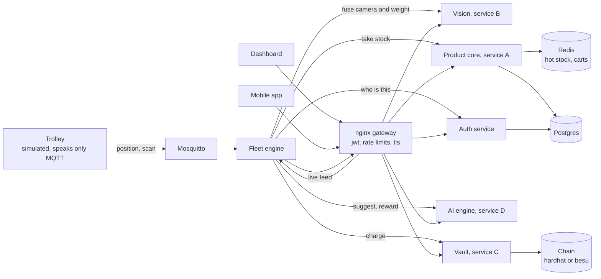
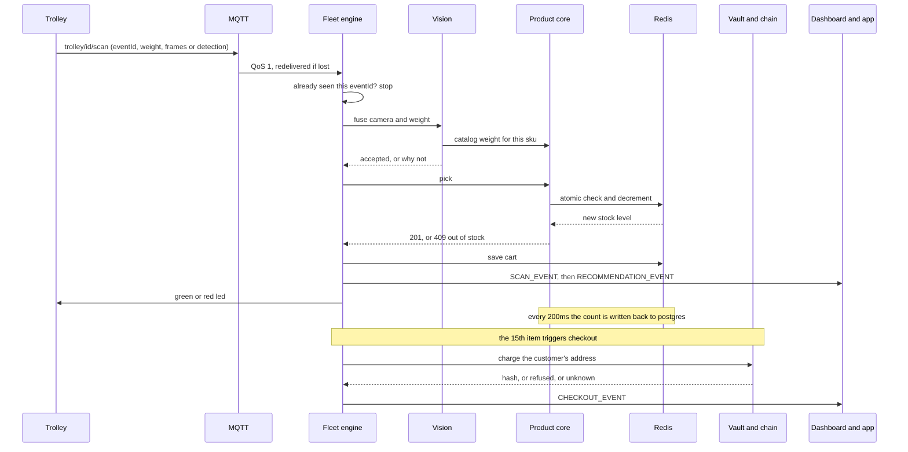
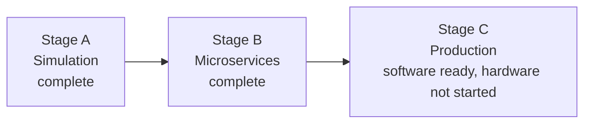

# ASE-PRIME Architecture

How the system is built today. Chapter numbers refer to the spec, `Automated Supermarket Ecosystem.pdf`. Diagrams are Mermaid, GitHub renders them.

## 1. The connected system (stage B)

Outside the stack, only the gateway and the broker can be reached. Everything else has no published port, and on Kubernetes network policies block anything not on each service's list.

## 2. One item going into a cart

## 3. What happens when things fail

| Failure | Behaviour | Tested in |
|---|---|---|
| Same scan delivered twice | Counts once, including after a restart | `fleet-engine` unit tests |
| Vision down | Scan refused with a reason, nothing unverified enters a cart | `e2e/loop.sh` |
| Product core down | Scan refused, cart unchanged | `fleet-engine` unit tests |
| Redis down | Picks fall back to versioned Postgres updates. When it returns, the lower count wins, so nothing is sold twice | `e2e/loop.sh` |
| Fleet engine killed | Carts come back from Redis, the broker holds scans for it, nobody is charged twice | `e2e/loop.sh`, `k8s/cluster-checks.sh` |
| Vault times out during a charge | Never retried, stock kept, staff alerted. It might have gone through | `fleet-engine` unit tests |
| Vault refuses, or was never reached | Stock released, cart cleared, staff alerted | `fleet-engine` unit tests |
| AI engine down or slow | Scans carry on, no suggestions | `fleet-engine` unit tests |
| One validator down of four | Checkouts carry on, it catches up when it returns | `e2e/besu.sh` |
| Two validators down of four | Chain halts rather than forking, resumes with a quorum | `e2e/besu.sh` |
| Token expires on an open feed | Connection closes, client reconnects with a fresh token or returns to login | `fleet-engine`, browser test |
| Malformed or hostile MQTT message | Logged and dropped | `fleet-engine` unit tests |

## 4. Security (chapter 10)

- **Tokens.** Access tokens are signed JWTs that last 15 minutes. Refresh tokens rotate, and reuse revokes the session. Passwords use scrypt.
- **Gateway.** nginx asks the auth service about every protected request, then passes on who the user is. Client-sent identity headers are overwritten. Login attempts are limited to 30 a minute per address. TLS is available with `make stage-b-tls`.
- **Customers see only their own data.** That covers wallet, cart and the live feed. They can't call the vault, take stock or send feedback to the model.
- **Broker.** Every client logs in, and each role can only use its own topics, so a compromised trolley can't forge store alerts.
- **Network.** See section 1.
- **Right to be forgotten.** The chain stores addresses only. The link from a person to an address lives in Postgres, and deleting it leaves the chain history anonymous. Purchase data given to the recommender has no customer id at all.
- **Containers.** No service runs as root. Secrets are generated at setup and never committed.

Known gaps: mutual TLS between services is only available through the optional Istio component, which hasn't been run. Refresh tokens are in browser session storage and app preferences rather than a platform keychain. The vault signs every transaction with one key, so customers don't hold their own.

## 5. Where this differs from the spec, on purpose

| Spec | Built | Why |
|---|---|---|
| MongoDB for product attributes | Postgres only | No feature needs a second database yet |
| Redis Cluster | Single Redis, cluster-safe key layout | Same commands, moving to a cluster is a deployment change |
| Kalman filter or Bayesian network | Bayesian | The spec allows either |
| TFX, Milvus | numpy item-item model | 33 products don't need a vector database |
| PyTorch to C++ inference, DeepStream | Python and onnxruntime on CPU | Stage B has no GPU. The Jetson path is in `stage-c-production/vision` |
| GitLab, Harbor, SonarQube | GitHub Actions, GHCR | The repo is on GitHub |
| BLoC in the app | Provider | Works, and the state classes are already testable. Moving later is contained |
| drift (SQLite) in the app | Key-value cache | A catalog this size is read whole, never queried |
| App queues "add to cart" offline | Not built, reconciliation is | Items only enter a cart through a trolley, after vision and weight agree. An add from a phone would bill for something nothing verified. The broker already holds trolley scans during an outage |
| IBFT 2.0 | IBFT 2.0 as specified | Besu now recommends QBFT for new networks and keeps IBFT 2.0 for existing ones. Worth deciding before going live |

## 6. Stage progression

Stage A still works on its own: the dashboard and app run against the simulator with no login unless they're built for stage B. All the event shapes are shared.
