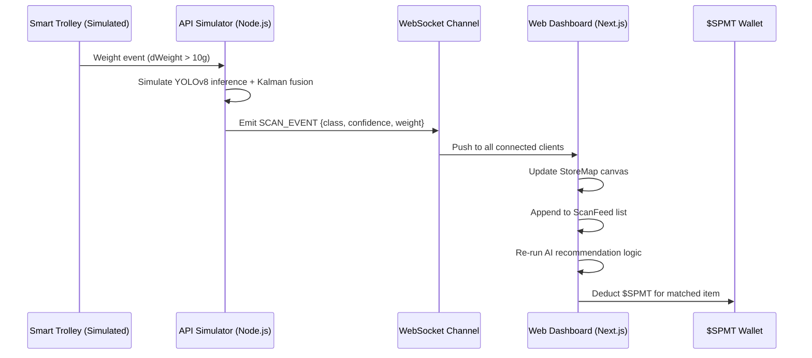
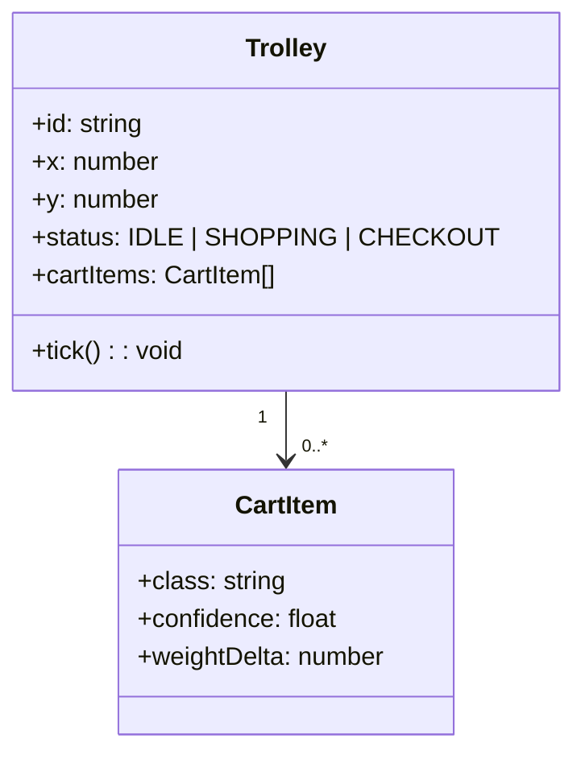
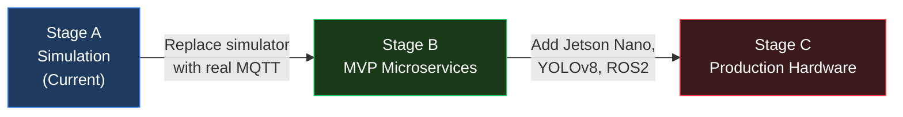

# ASE-PRIME Architecture

This document lives in `docs/` and covers the full system design as of Stage A.
Diagrams are written in Mermaid — paste them into https://mermaid.live to render.

---

## 1. High-Level Flow

---

## 2. Trolley Data Model

---

## 3. WebSocket Event Types

| Event Type | Direction | Payload |
|---|---|---|
| `INFO` | Server → Client | Initial connection message |
| `TROLLEY_POSITIONS` | Server → Client | Array of all trolley states (every 1s) |
| `SCAN_EVENT` | Server → Client | Single item detection event |

---

## 4. Stage Progression

---

## 5. Technology Decisions

| Layer | Stage A (Now) | Stage B | Stage C |
|---|---|---|---|
| Frontend | Next.js (Web) | Next.js + Flutter | Flutter (Native) |
| Backend | Express + WS | NestJS Microservices | Same + edge compute |
| Database | In-memory | PostgreSQL + Redis | Same |
| Messaging | WebSocket | MQTT + RabbitMQ | ROS 2 DDS |
| AI | Rule-based recs | Collaborative filter | YOLOv8 on Jetson |
| Blockchain | Mock ledger | Hyperledger Besu | Same |
| DevOps | Local | Docker Compose | Kubernetes (EKS) |
